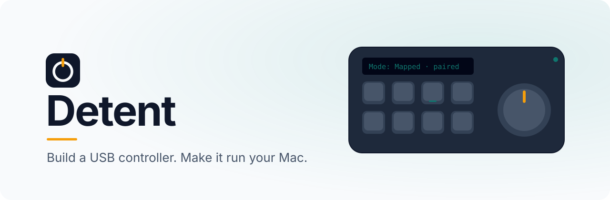

<p align="center">
  <picture>
    <source media="(prefers-color-scheme: dark)" srcset=".github/assets/banner-dark.svg">
    
  </picture>
</p>

<p align="center">
  <a href="https://github.com/gittielabs/detent/releases/latest"></a>
  <a href="https://github.com/gittielabs/detent/actions/workflows/ci.yml"></a>
  <a href="https://gittielabs.github.io/detent/"></a>
  
  <a href="LICENSE"></a>
</p>

<p align="center">
  <a href="https://github.com/gittielabs/detent/releases/latest"><b>Download</b></a>
  &nbsp;·&nbsp;
  <a href="https://gittielabs.github.io/detent/"><b>Documentation</b></a>
  &nbsp;·&nbsp;
  <a href="https://gittielabs.github.io/detent/build-your-own.html"><b>Build your own device</b></a>
</p>

---

**Detent** is a macOS menu bar app and open firmware for building your own physical controllers. Wire buttons and knobs to a small USB board, pair it, and every press or turn runs an action on your Mac.

Only devices you pair are listened to. A Detent device doesn't pretend to be a keyboard, so it can't type into whatever has focus, and your real keyboard never triggers anything.

## What a press can do

| Action | For example |
| --- | --- |
| **Open an app** | Button 1 opens Mail |
| **Send a shortcut** | Button 3 sends Extrude, only while Plasticity is in front |
| **Run an AppleScript** | Button 4 brings Finder forward with a new window |
| **Change the volume** | The knob turns the volume; pressing it mutes |
| **Show a dashboard** | A button shows a web page full screen on a chosen display |

Each mapping is one control, one action and one scope: everywhere, or only while a chosen app is in front.

## How it fits together

- **The device:** an ESP32-S3 or Raspberry Pi Pico board running Detent's firmware, with buttons, optional knobs (rotary encoders) and an optional 128×64 OLED. When it connects, it tells the app what controls it has.
- **The app:** lives in the menu bar. It pairs devices, keeps your mappings, and runs the actions. Three screens: Devices, Mappings and Test.
- **The protocol:** a small, documented USB HID format ([`docs/protocol.md`](docs/protocol.md)), so you can write your own firmware.

## Boards

| Board | Status |
| --- | --- |
| Seeed XIAO ESP32-S3 | Tested on hardware: buttons, an encoder and an OLED |
| ESP32-S3 DevKitC (N16R8) | Builds; first hardware run pending |
| Adafruit ESP32-S3 Feather | Early: BOOT as button 1 until its headers are on |
| Raspberry Pi Pico | Experimental: USB link tested, pin map a placeholder |

Each release carries firmware for every board. Want your own layout? The [Build your own device](https://gittielabs.github.io/detent/build-your-own.html) guide walks through a complete one. Boards built on the original ESP32 (no "S3") can't work: they have no native USB.

## Development

<details>
<summary><b>Build the app (macOS)</b></summary>

Requirements: Rust stable, Node with pnpm, PlatformIO Core 6.2 or newer, Xcode command line tools, and an Apple Development signing identity.

PlatformIO: CI pins 6.2.0. If `pio --version` shows `6.2.0.post1`, the firmware platform refuses to install (it reads `.post1` as a pre-release); fix it with `~/.platformio/penv/bin/pip install --force-reinstall --no-deps platformio==6.2.0`.

Find your identity, set it, and build:

```bash
security find-identity -v -p codesigning
export APPLE_SIGNING_IDENTITY="Apple Development: Your Name (TEAMID)"
scripts/build-dev.sh        # or: just build-dev
```

The script builds a debug `Detent.app` at `target/debug/bundle/macos/Detent.app`, signs it, and checks the signature. It stops with a clear message if `APPLE_SIGNING_IDENTITY` is unset, set to `-` (ad hoc), or doesn't match an identity in your keychain.

Dev builds are signed with a stable identity so macOS permission grants (Accessibility) survive rebuilds. Ad hoc signatures change every build and reset those grants. Keep the identity in your shell profile or environment; it never goes in the repo.

</details>

<details>
<summary><b>Firmware, tests and tools</b></summary>

- `just fw` builds every board's firmware; `just fw-upload <env>` flashes one (for example `just fw-upload xiao_esp32s3`).
- `just fmt`, `just lint` and `just test` check the Rust workspace; `just fw-test` runs the firmware's native tests.
- `just probe` prints a device's decoded events and reopens after unplug; `just probe --raw` adds hex; `just probe list` shows what's attached.
- `just site` builds the documentation site from `site/`.

Run `just` to list everything.

</details>

<details>
<summary><b>Releases</b></summary>

Releases are notarized with the maintainer's Apple credentials. To ship a fork, use your own Developer ID and notary profile (`APPLE_SIGNING_IDENTITY`, `APPLE_NOTARY_PROFILE`): `just build-release`, `just notarize-release`, then `just release` and `just release-publish`.

</details>

### Repository layout

| Path | What's there |
| --- | --- |
| `app/` | Tauri 2 app: Rust backend, TypeScript UI |
| `firmware/` | PlatformIO project for the ESP32-S3 and RP2040 boards |
| `protocol/` | Rust crate for the USB wire format; the firmware's C header is generated from it |
| `tools/ctl-probe/` | CLI that prints decoded device events |
| `site/` | The user documentation site (mdBook, on GitHub Pages) |
| `docs/` | Product, architecture, protocol, decisions, roadmap and acceptance notes |

## License

Apache License 2.0. See [`LICENSE`](LICENSE).
